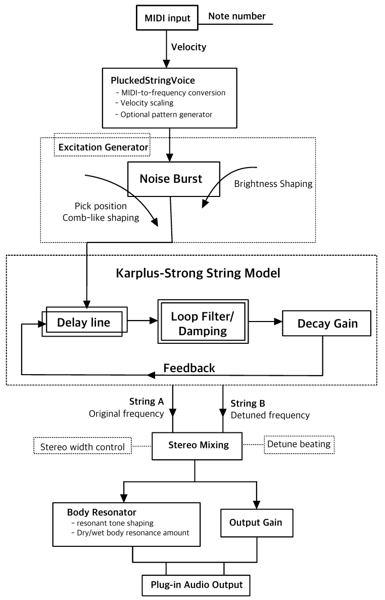

# Synthesis Design and Implementation

## Karplus–Strong String Model

When a MIDI note is received, the MIDI note number is converted into a
frequency. This frequency determines the delay length of the virtual
string.

A short noise burst excites the delay line. The delayed signal is then
passed through a damping filter and decay gain before being fed back into
the delay line.

## Signal Flow

*Figure 1. Simplified implementation and signal flow.*

## Expressive Parameters

### Brightness

Brightness changes the spectral content of the initial excitation,
allowing the pluck to sound softer or sharper.

### Damping

Damping operates inside the feedback loop and controls how quickly
high-frequency energy disappears.

### Pick Position

Pick position uses comb-like shaping of the excitation signal to
approximate the spectral changes produced by plucking different parts of
a physical string.

### Double-String Detuning

Each voice contains two Karplus–Strong strings. The second string is
slightly detuned and can be spread across the stereo field.

### Body Resonance

A simplified resonant tone-shaping stage is applied after the string
model to make the output fuller and more instrument-like.